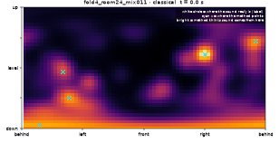

# SecondEar

**I'm deaf in one ear. I built a model that hears where sounds come from, then gave it one ear
and measured what it loses.**

SecondEar is a sound-localization model (SELD: sound event localization and detection) trained on
real room recordings, plus a one-ear experiment and a 3D coffee-shop viewer that shows what a
listener with two ears, or one, perceives.

**Try the viewer: <https://johnfok119.github.io/second-ear/>**

*Assistive awareness research, not a medical device.*

## What it shows

| Piece | What it is |
|---|---|
| Viewer | A coffee shop in your browser. The floor is a grid of bars that rise and fall as sound travels (a simple 2D simulation, not real acoustics). A ring around the listener's head shows where the model thinks each sound is. Switch ears and watch it change. |
| Model | A neural network (a program that learns from examples) that listens through 4 microphones and draws a heat map of where sounds are, 10 times a second. It is scored with the official DCASE contest metrics (DCASE: Detection and Classification of Acoustic Scenes and Events) next to the published baseline. |
| One-ear experiment | The same kinds of sounds rendered into left-ear and right-ear audio with public head filters. Two ears vs left only vs right only, compared to published numbers for people who hear with one ear. |

Design: [ARCHITECTURE.md](ARCHITECTURE.md) · Plain-English write-up of each phase: [LEARNING.md](LEARNING.md) · Build steps: [PLAN.md](PLAN.md) · Sources: [docs/research](docs/research/2026-10-22-sources.md)

## Results

All numbers are on the 78 test recordings (the "dev-test" split) of STARSS23 (Sony-TAu Realistic
Spatial Soundscapes 2023, real recordings made in 16 rooms). The learned models were trained on
the STARSS23 training recordings only, with no synthetic DCASE mixtures.

Terms: **LE** = localization error, the average angle between a guess and the true sound (lower
is better). **F20** = a score that counts a guess as right if it is within 20 degrees of a real
sound (higher is better; 100 % is perfect). **Front-back** = how often a guess is far off but
would be right if mirrored front-to-back (lower is better). **Chance** = random directions, the
score of "no skill".

### Phase 1-2: where is the sound? (any sound, per 0.1 second)

| Method | LE ↓ | precision20 ↑ | recall20 ↑ | F20 ↑ (any sound) | front-back ↓ | Official F20 ↑ (class-aware) |
|---|---|---|---|---|---|---|
| Chance (classical's count per frame) | 73.3° | 3.7 % | 4.5 % | 4.0 % | 2.2 % | n/a |
| Classical (hand-made, no training) | 43.7° | 21.2 % | 26.2 % | 23.5 % | 0.6 % | n/a: finds directions, not classes |
| Baseline (DCASE 2023, our run, epoch 96) | 25.0° | 49.4 % | 35.7 % | 41.4 % | 0.6 % | 15.6 % |
| Heat-map model (ours, epoch 39) | 25.8° | 47.5 % | 13.5 % | 21.0 % | 1.3 % | 9.7 % |

The published DCASE 2023 baseline, trained with extra synthetic data, reports an official F20 of
29.9 %. Our baseline run does not use that data. Precision20 = of the guesses, how many were
within 20 degrees; recall20 = of the real sounds, how many got such a guess.



*The classical method's direction map over a 30-second real test recording (fold 4, room 24).*

What the table says: the heat-map model points as accurately as the baseline when it fires
(25.8° vs 25.0°) but fires on far fewer frames (recall 13.5 % vs 35.7 %), because its maps often
peak below the 0.5 cut-off used to turn a map into guesses.

### One-ear experiment

Two-ear and one-ear models are trained and tested on binaural scenes (left-ear and right-ear
audio) that we render ourselves. Source: `results/one_ear_valthr/table.md`.

<!-- one-ear:start -->
| Condition | LE ↓ | F20 ↑ | Front-back ↓ | Guesses per real sound | Frontal azimuth error (deg) |
|---|---|---|---|---|---|
| Two ears | 64.4 | 0.034 | 0.036 | 1.41 | 36.5 |
| Two-ear model, left muted | 148.2 | 0.003 | 0.004 | 0.85 | 75.3 |
| Two-ear model, right muted | 144.6 | 0.001 | 0.001 | 0.26 | 77.3 |
| One-ear model, left (trained) | 70.3 | 0.018 | 0.011 | 3.98 | 30.9 |
| One-ear model, right (trained) | 66.7 | 0.017 | 0.004 | 5.76 | 25.0 |
| Classical ITD (class-agnostic) | 54.7 | n/a | 0.075 | 0.55 | 20.8 |
| Humans, one ear (SSD; Aruffo 2025) | n/a | n/a | n/a | n/a | 22.4 |
| Humans, two ears (Aruffo 2025) | n/a | n/a | n/a | n/a | 3.7 |
<!-- one-ear:end -->

Decoding thresholds were picked on the validation split per model (two ears 0.30, left 0.25, right 0.20); the fixed-0.5 table is `results/one_ear/table.md`. The one-ear models make 4-6 guesses per real sound, which flatters their recall and frontal error.

"Muted" means the model was trained with two ears and one ear is silenced at test time.
"Trained" means the model was trained with only that ear. Classical ITD is a hand-made method
that uses ITD (interaural time difference: the tiny delay between the two ears).

## How to run

You need Python 3.11 and [uv](https://docs.astral.sh/uv/). A CUDA graphics card is used for
training if present; the scripts fall back to CPU.

```bash
uv sync                  # install everything
uv run pytest -q         # run the tests
```

Get the data (STARSS23 dev set; the script checks the publisher's md5 checksums):

```bash
uv run python scripts/download_starss23.py
```

Phase 1: classical method.

```bash
uv run python scripts/eval_classical.py --root data/starss23 --split dev-test --workers 4 --out results/classical
```

Phase 2: baseline and heat-map model. The training scripts read cached features
(`data/features/...`), built by `scripts/extract_baseline_features.py`.

```bash
uv run python scripts/train_baseline.py --epochs 100
uv run python scripts/eval_baseline.py --split dev-test --out results/baseline

uv run python scripts/train_heatmap.py --config configs/heatmap_foa.yaml
uv run python scripts/eval_heatmap.py --config configs/heatmap_foa.yaml
```

Phase 3: one-ear experiment. Render binaural scenes, train per-ear models (configs
`heatmap_binaural.yaml`, `heatmap_left.yaml`, `heatmap_right.yaml`), mute one ear at test, then
build the table.

```bash
uv run python scripts/generate_binaural.py --split train --n-scenes 600
uv run python scripts/generate_binaural.py --split train --n-scenes 100 --start-seed 100000 --out data/binaural/val   # validation scenes
uv run python scripts/generate_binaural.py --split test --n-scenes 100
uv run python scripts/train_heatmap.py --config configs/heatmap_binaural.yaml
uv run python scripts/eval_heatmap.py --config configs/heatmap_binaural.yaml --mute left
uv run python scripts/one_ear_table.py --results results --out results/one_ear
```

Viewer clips and the coffee-shop scene:

```bash
uv run python scripts/export_clip.py --clip <clip-name> --model heatmap --config configs/heatmap_foa.yaml
uv run python scripts/render_coffee_shop.py
```

Viewer locally (no build step), then open <http://localhost:8000>:

```bash
uv run python -m http.server --directory web
```

## Limitations

- **No synthetic data.** The published DCASE baseline also trains on synthetic mixtures made by
  the contest organisers. We train on the real recordings only, so our baseline scores lower than
  the published one (official F20 15.6 % vs 29.9 %).
- **The best training epoch was picked using the test split's score**, as in the DCASE recipe.
  That is slightly optimistic, because the test set helped choose the model.
- **The heat-map model under-detects.** Guesses are made where the map is above a fixed 0.5
  threshold. The threshold was set before testing and not tuned; many maps peak below it, so
  recall is low (13.5 %). Choosing it on held-out training data is the obvious next step.
- **Training stopped early** at epoch 80 of 100 on a plateau; the best epoch was 39.
- **The two-ear data is rendered, not recorded.** Binaural scenes are built by playing dry clips
  through public head filters and simulated room echo (called Route B in ARCHITECTURE.md). The
  other route, converting the real recordings, loses much of the delay between the ears, so it was
  not used. A model trained on rendered scenes may not match real ears in real rooms.
- **The viewer's floor waves are a 2D simulation** for readability, not a measurement of real
  sound in the room.
- **Few head shapes.** Head filters come from the HUTUBS and SADIE II sets only, and the coffee-shop
  viewer uses one HUTUBS subject (pp8).

## Model card: heat-map model

- **Model:** the same encoder as the DCASE 2023 baseline, with a map head. For each 0.1 second it
  outputs, for every sound class, a grid over direction (azimuth and elevation, 5 degree steps).
  Trained with a focal loss (a loss that focuses on the rare cells where a sound really is).
  Config: `configs/heatmap_foa.yaml`.
- **Intended use:** research, learning and a portfolio project; exploring how much direction
  information is lost with one ear; assistive-awareness research. **Not a medical device**, not a
  hearing aid, and not for safety decisions.
- **Training data:** STARSS23 dev-train recordings (real rooms, 4-channel FOA audio), no synthetic
  mixtures. The one-ear variants are trained on rendered binaural scenes (FSD50K clips, HUTUBS and
  SADIE II head filters).
- **Evaluation data:** STARSS23 dev-test, 78 recordings. One-ear results: see the table above (`results/one_ear_valthr/table.md`).
- **Metrics (epoch 39):** official F20 9.7 %, LE 41.2°, localization recall 13.3 %, ER20 0.88
  (error rate at 20 degrees, lower is better), SELD score 0.720 (lower is better). Any-sound: LE
  25.8°, precision20 47.5 %, recall20 13.5 %, F20 21.0 %. Source: `results/m2_table.md`.
- **Known failure modes:** misses many real sounds (low recall, see Limitations); reflections off
  walls and floor can pull a guess toward the wrong direction; overlapping sounds blur; with one
  ear, front and back are easily confused (the reason the model outputs a map, not one arrow).
  Only 13 sound classes (speech, clapping, telephone, laughter, domestic sounds, footsteps, door,
  music, musical instrument, water tap, bell, knock), and only the rooms in Finland and Japan.
- **Licence of the data used:** STARSS23 MIT; HUTUBS CC BY 4.0; SADIE II Apache 2.0; FSD50K
  CC BY 4.0 overall with per-clip licences (see credits).
- **Licence of this repo's code:** TBD (no licence file in the repo yet).

## Credits and licences

- **STARSS23** dataset, Zenodo record 7880637: <https://zenodo.org/records/7880637>. MIT licence.
- **DCASE 2023 SELD baseline** code by Sharath Adavanne and the DCASE authors, vendored in
  `src/secondear/models/dcase2023/` (source: <https://github.com/sharathadavanne/seld-dcase2023>).
  MIT licence, kept in `src/secondear/models/dcase2023/LICENSE`. Changes are listed in that
  folder's README.
- **HUTUBS** head-related transfer functions, TU Berlin, CC BY 4.0:
  <https://depositonce.tu-berlin.de/items/dc2a3076-a291-417e-97f0-7697e332c960/full>
- **SADIE II** head-related transfer functions, Apache 2.0: <https://zenodo.org/records/10886409>
- **FSD50K** sound clips, CC BY 4.0 overall with per-clip licences: <https://zenodo.org/records/4060432>
- Per-clip credits for the coffee-shop audio (Freesound uploaders, licences) and the head filter
  used: [web/CREDITS.md](web/CREDITS.md)
- Human single-sided-deafness comparison: Aruffo et al. 2025, Audiology Research 15(4):85,
  <https://pmc.ncbi.nlm.nih.gov/articles/PMC12286218/>
- 3D viewer: [Three.js](https://threejs.org/) (pinned version, loaded from a CDN).
